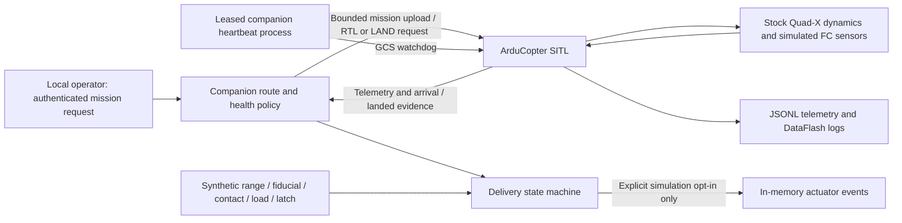

# Compact delivery quad — simulation prototype

This repository now contains a bounded Python mission/payload coordinator and a runnable **ArduCopter 4.6.3 SITL** demo. ArduCopter owns stabilization, navigation, motor mixing, arming checks and independent failsafes. The companion never implements a flight-control loop. No hardware target, serial connection option, servo driver or live release command is provided.

The selected concept is Quad-X, 650 mm diagonal, 16-inch P16×5.4 propellers, four MN4110 KV400 motors, FLAME 60A 12S V2 ESCs, and one **6S 10 Ah** battery. Study takeoff mass **5.70 kg** includes a **1.814 kg** package. These are assumptions, not verified mass, thrust, CG, endurance or flightworthiness. The study's 2-mile margins (23% calm, 1.4% at 5 m/s wind) are not performance guarantees. The separate 24-inch/12S, 5-mile candidate is outside this project.

**The tested flight dynamics are ArduPilot's unmodified stock X quad: 3 kg, 350 mm, 3S.** They exercise software behavior, not selected-aircraft performance. The conceptual 6S sensor/energy model is separate; no selected hardware performance has been validated. Payload release changes a logical payload state and energy estimate, not the stock simulator's mass.

From this directory:

```bash
bash simulation/setup.sh                # download pinned Python/dependencies and build native SITL
bash simulation/demo.sh                 # upload/validate only; stays disarmed
bash simulation/demo.sh --sitl-flight   # explicit simulated flight; release remains inert
bash simulation/demo.sh --sitl-flight --enable-simulated-release
bash simulation/test.sh                 # unit + explicit owned-SITL flight suite
```

Prerequisites: Git, uv, and a native C/C++ compiler. The build was tested on Apple Silicon macOS; see [setup](docs/SETUP.md) for commands, platform limits and exact versions. No Gazebo, ROS 2, external ground station or physical vehicle is needed. All tests are deterministic policy scenarios; real-time scheduling and stock SITL sensor noise can vary.

Expected successful default flight output:

```text
VALIDATED    authenticated route and loaded return reserve accepted
OUTBOUND     flight controller reports airborne
AT_PAD       landed at registered destination
DELIVERY     evaluating local interlocks
RETURNING    retained payload; return sizing 13.542 Wh
COMPLETE     home, landed, disarmed
PASS: COMPLETE; payload=retained
```

The world has a launch pad `(0,0)`, waypoint `(10,0)`, delivery pad `(20,10)`, a static obstacle, and a reversed return route at 8 m. Coordinates are **north/east/up metres** relative to launch. GPS mapping uses the documented local tangent approximation. Obstacles are planning exclusion cylinders, not collision geometry or an avoidance system. See [world.json](simulation/world.json).



- [Architecture and interface ownership](docs/ARCHITECTURE.md)
- [All parameter meanings, selected BOM and unresolved wiring](docs/HARDWARE.md)
- [Sensor models and scenario coverage](docs/SCENARIOS.md)
- [Test evidence and limitations](docs/TEST_RESULTS.md)
- [Later bench-test prerequisites](docs/BENCH.md)
- [Flight Ops live SITL dashboard and bridge](docs/FLIGHT_OPS.md)
- [SWARM / Flightpath full-distance Columbia routes](docs/GEOGRAPHIC_FLIGHTS.md)

Reusable software lives in `flight-software/quadstack`, simulation tools in `simulation`, and checks in `tests`. Generated runs are ignored under `simulation/runs/`; each contains `result.json`, telemetry, the command/version/hash manifest and SITL/DataFlash logs. Keys exist only in memory and are not logged.

Legacy root-level experiments are omitted from this submission package; use `simulation/setup.sh` to install this stack.

SITL success does not establish flight readiness, reliable delivery, collision avoidance, regulatory compliance or validated range. Hardware integration remains blocked on measured wiring, calibration and the reviewed bench procedure.
